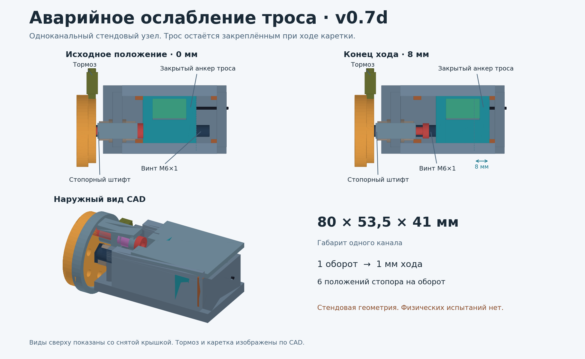

# v0.7d — механическое аварийное ослабление троса

**2026-11-11. Стендовая CAD-модель одного канала.** Предшественники: [v0.7b](../v0.7b/README.md), [v0.7c](../v0.7c/README.md), [аудит троса v0.6b](../../cad/v0.6b/README.md), [аудит пыльника v0.6c](../../cad/v0.6c/README.md) и [MASTER_PROMPT v4.2](../../docs/MASTER_PROMPT_v4.2.md).



## Как работает

Неподвижная металлическая рама содержит осевой упор ходового винта и направляющую троса. Заблокированный привод представлен глухим анкером на каретке. В реальной интеграции этот анкер должен представлять фиксированный выход вместе с его опорой: каретка сдвигает весь закреплённый выход к пальцу, не пытаясь провернуть редуктор. Это функциональное освобождение натяжения без сбрасывания наконечника. Металлические направляющие удерживают каретку, два упора ограничивают её ход. За счёт отдельной возвратной системы пальца ослабленный трос может дать суставу открыться. Возвратная система и открытие целого пальца в этом CAD не моделируются.

1. В исходном положении стопорный подпружиненный штифт входит в диск и блокирует вращение винта. Оба конца троса остаются закреплёнными.
2. При отводе штифта оператор вращает колесо. Винт М6×1 перемещает невращающуюся каретку к пальцу по 1 мм за оборот. Колодка с отдельным поджатием остаётся на ободе диска. Резьба передаёт нагрузку в раму во время всего движения.
3. На диске шесть отверстий. Штифт полностью входит только после совмещения. Шаг 0,167 мм означает расстояние между соседними фиксированными положениями. Это не гарантированная длина свободного выбега при потере торможения.
4. В конце движения сохраняются зацепление гайки и удержание каретки. 8 мм хода перекрывают 6,074 мм из локальной модели MCP на 1,926 мм по номинальной геометрии. Реальный запас на растяжение, люфт, возврат, отклонение трассы и прочие пальцы предстоит измерить.

При заклинивании троса после кассеты каретка может ослабить свободный участок, но сустав остаётся заблокированным. При открытии крючкового хвата предмет может выпасть даже при плавном ходе каретки. На стенде подвес или имитатор нагрузки удерживает независимый ловитель. Ни один сценарий не даёт допуска к ношению или переносу груза.

## Проверка расчётом и CAD

| Сценарий | Тяга, Н | Момент обратного хода винта без трения, Н·м | Момент на направляющих от смещения 12 мм, Н·м | Запас тормоза при условно измеренных 0,035 Н·м |
|---|---:|---:|---:|---:|
| Проектный диапазон отдельного малонагруженного стенда | 50 | 0,0080 | 0,600 | +0,0270 Н·м |
| 10 кг равномерно на 4 пальцах, один трос | 281,80 | 0,0448 | 3,382 | −0,0098 Н·м |
| Те же 10 кг на одном пальце | 1 127,20 | 0,1794 | 13,526 | −0,1444 Н·м |
| Один палец, условный множитель ×2 | 2 254,40 | 0,3588 | 27,053 | −0,3238 Н·м |

Расчёт нагрузки повторяет плечи 40/5,8 мм и условный КПД 0,6 из v0.7b. Тормоз 0,035–0,060 Н·м — гипотеза для проверяемого на стенде диапазона 50 Н. При нулевом трении осевого упора самоторможение винта в модели исчезает при коэффициенте трения резьбы ниже 0,0515. Уравнения учитывают угол профиля, а зависимость обратного хода винта от геометрии и трения сверена с [Roton](https://www.roton.com/screw-university/screw-actions/screw-backdriving-efficiency/). Трения тормоза и резьбы, усилие руки, заедание от перекоса, трение при пыли/влаге, нагрев, несущая способность резьбы и усталость физически не измерены. В примере 50 Н максимум касательной силы на ободе Ø38 в расчётной сетке с условным верхним моментом тормоза около 6,64 Н. Усилие отвода стопора и хват кистью не входят в эту цифру.

Идеальная работа при постоянной силе 281,8 Н и ходе 6,074 мм — 1,71 Дж на один трос, 6,85 Дж на четыре. Полный аварийный ход, запасённая энергия пружин, движение пальца и падение предмета требуют отдельных измерений. Номинальные напряжения винта и среза штифта в JSON используются только как сравнительные оценки. 3D-FEA, усталостный анализ и физические испытания не проводились. До расчёта прочности нужны реальный способ крепления анкера, опорная схема, болтовые соединения и спецификация материалов. [ISO 22523](https://www.iso.org/standard/37546.html) и [ISO 14971](https://www.iso.org/standard/72704.html) использованы как ориентиры для испытаний и управления рисками. Соответствие не оценивалось.

### Геометрия

- **44 тела × 170 поз**, из них 101 с отведённым штифтом, 49 в фиксированных положениях и 20 промежуточных положений штифта. 7 480 валидных состояний тел, 160 820 пар, 5 032 BRep-пересечения после фильтра по габариту. Проникновений выше 0,01 мм³ в этих позах нет. Контроль с намеренно несоосным штифтом даёт 37,70 мм³ проникновения. Это дискретная проверка номинальной геометрии, с упрощёнными резьбой, пружинами, креплением диска, приводом и анкером.
- Первая итерация выявила 300 записей о пересечениях в двух зонах. Упор зацеплял пружину и её плечо. Крышка пересекала отведённый штифт и рукоятку. Добавлены выборки вокруг обоих ходов. См. [сводку до исправления](cad_before_fix.json) и [результат после исправления](cad_results.json).
- Функциональный габарит одного узла **80 × 53,5 × 41 мм**, без пространства для кисти оператора, пыльника и конечной электроники. Прямая осевая установка в 50-мм модуль запястья отвергнута. Четыре неперекрывающихся прямоугольных резерва в одном слое требуют 17 120 мм² при плане ладони 10 370 мм². Это ограничение конкретной схемы упаковки.
- В проверке с опубликованным STEP v0.5d у всех 72 пробных размещений на высотах 2–44 мм есть пересечения с моделью открытой кисти. Девять контрольных размещений на высоте 50 мм проходят за счёт выноса наружу. Пыльник в движении, проводка, прокладка пяти тросов и доступ пальцев оператора в проверку не входят. [Матрица размещений](packaging_results.json).

**Вывод этапа:** узел пригоден как кандидат на одноканальный стенд. Тормоз и компоновка не проходят расчётные ограничения для целевого хвата 10 кг. Объединение четырёх тросов на общей каретке не снимает силовой вопрос: даже при равномерном сценарии сумма тяги достигает примерно 1 127 Н. Для компактной версии потребуется отдельная силовая схема, а для дистального клина — независимое решение рядом с суставом.

## Файлы и повторение

| Файл | Назначение |
|---|---|
| [release_cad.py](release_cad.py) | Редактируемая сборка CadQuery и BRep-аудит |
| [release_0mm.step.gz](exports/release_0mm.step.gz), [release_8mm.step.gz](exports/release_8mm.step.gz) | Сборки в крайних положениях, распаковать перед импортом |
| [knob_fit_only.stl](exports/knob_fit_only.stl) | Примерочная рукоятка для проверки положения пальцев на ненагруженном макете |
| [release_model.py](release_model.py), [release_results.json](release_results.json) | Формулы и численные сценарии |
| [packaging_check.py](packaging_check.py), [packaging_results.json](packaging_results.json) | Пересечения с открытой кистью v0.5d |
| [BENCH.md](BENCH.md), [BOM.md](BOM.md) | Сборка одной рукой, защита, проверочный протокол, доступные детали |

Из каталога этой версии, Python 3.11+ и CadQuery 2.7.0:

```sh
python release_model.py
python -m unittest -v test_release_model.py
python release_cad.py --audit --export exports
python packaging_check.py
python render_preview.py
```

Визуализация требует Matplotlib и NumPy. Экспорт создаёт обычные STEP. Опубликованные STEP сжаты gzip. Печатная ручка предназначена для примерки на столе. При физической разработке сначала проверяется закрытый ненагруженный стенд с закреплённым основанием.
