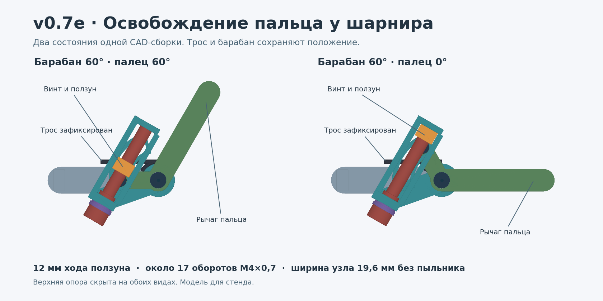

# v0.7e — освобождение пальца при клине троса перед шарниром

**11.11.2026.** Однопальцевый стендовый вариант. Основание — [MASTER_PROMPT v4.2](../../docs/MASTER_PROMPT_v4.2.md), [v0.7d](../v0.7d/README.md) и проверка трассы [v0.6b](../../cad/v0.6b/README.md).



## Схема

У тросового барабана и пальца общая ось MCP, но отдельные вращающиеся детали. На пальце находится палец-толкатель Ø4 мм. Он остаётся в замкнутом дуговом пазу сектора барабана. Выдвижной упор на винте ограничивает относительный поворот. В обычном положении упор передаёт движение закрытия. При неподвижном барабане винт отводит упор, и открывающий момент может повернуть палец относительно барабана. Трос сохраняет крепление и положение. Для открытия без внешнего момента нужна возвратная пружина пальца. Её выбор и физическая проверка остаются открытыми.

Замкнутый паз удерживает толкатель при изменении положения упора. Пружинная шайба и фрикционное кольцо представлены как резерв тормоза винта. На стенде ещё нужно проверить удержание винта, усилие вращения и возможный выбег при поломке упора или падении трения. Схема обходит клин троса, который удерживает **барабан**. Клин самой оси MCP, паза или винта блокирует этот путь. При освобождении пальца груз может выпасть, поэтому на стенде его независимо удерживает ловитель.

## Что получилось

- **Кинематика.** Радиус толкателя 12 мм. Относительный поворот 0–60° даёт 12 мм хода упора. Для резьбы М4×0,7 это 17,14 оборота на один палец. При клине барабана на 15°, 30° и 45° расчёт даёт соответственно 4,13, 8,57 и 13,01 оборота. Модель ограничивает открытие нулевым углом неподвижным упором. Физический упор открытой фаланги и удержание возвратной пружины должны быть реализованы на стенде.
- **CAD.** 91 дискретная поза, 1 729 валидных состояний тел, 3 653 точные булевы проверки пар деталей и 728 точных проверок сегментов троса против деталей. В этих позах нет проникновений выше 0,01 мм³. Контроль с намеренно смещённым упором выявил 0,599 мм³. При 13 положениях неподвижного барабана от 0° до 60° с шагом 5° локальная геометрия дошла до положения пальца 0°. Трос представлен цилиндрическими отрезками. Упругая деформация и непрерывный проход не проверены.
- **Исправления.** В первой итерации дуговой паз разрезал щёку на две части, а пружинная шайба и головка винта пересекали элементы вилки. Расширил угловой сектор щёки, добавил выборку на верхней опоре и отвёл соединительную перемычку назад. У ползуна задано 0,15 мм номинального зазора у толкателя. [Первая итерация](cad_before_fix.json) · [Итог CAD](cad_results.json)
- **Компоновка.** У опубликованного открытого STEP v0.5d центры проксимальных тел по ширине идут с шагом 20,5 мм. Узел занимает 19,6 мм вдоль оси и оставляет 0,9 мм номинально между соседями. Две условные стенки пыльника по 0,5 мм уже исчерпывают зазор. При резерве 0,20 мм на каждый узел и рабочем зазоре 0,25 мм целевой габарит этой раскладки — **не шире 18,85 мм**. Это проверка осевого бюджета. Полная интеграция пяти пальцев, доступ к четырём винтам и подвижные пыльники остаются открытыми. [Раскладка](lane_results.json)

## Расчёт нагрузки

Худшее плечо упора по диапазону равно 12·cos(30°) ≈ 10,39 мм. Для оценки берётся открывающий момент на MCP, рассчитанный по плечу груза 40 мм. Случай нулевого трения винта даёт верхнюю оценку его обратного момента при заданной осевой силе. Тормоз 0,020–0,035 Н·м — гипотеза для стенда, а не измеренная характеристика. Зависимость обратного хода от трения и геометрии сверена с [Roton](https://www.roton.com/screw-university/screw-actions/screw-backdriving-efficiency/).

| Случай | Момент MCP, Н·м | Макс. осевая сила на упоре, Н | Обратный момент винта без трения, Н·м | Запас при тормозе 0,020 Н·м |
|---|---:|---:|---:|---:|
| Низконагруженная стендовая гипотеза | 0,100 | 9,6 | 0,0011 | +0,0189 |
| 10 кг на четырёх пальцах поровну, один палец | 0,981 | 94,4 | 0,0105 | +0,0095 |
| Те же 10 кг на одном пальце | 3,923 | 377,5 | 0,0421 | −0,0221 |
| Один палец, условный множитель ×2 | 7,845 | 754,9 | 0,0841 | −0,0641 |

Для Ø4 мм при условной консоли 2,5 мм оценка номинального изгиба толкателя в сценарии всего груза на одном пальце составляет около 150 МПа. Концентрация напряжений, смятие паза, удержание оси, фактическое зацепление резьбы и материал силовых деталей не проверены. FEA и физических испытаний нет. Увеличение шага винта до 1,5 мм сократило бы ход до восьми оборотов, но при тех же 377,5 Н подняло бы идеальный обратный момент до 0,090 Н·м. Простая замена винта не закрывает ограничение по торможению.

**Решение этапа.** Раздельный барабан и палец оставляем для проверки на стенде. Текущие индивидуальные винты отклонены как аварийное управление всей кистью из-за длительности хода, недостающего резерва под пыльники и тормоза в неблагоприятной нагрузке. Для следующей итерации требуется общее доступное управление удерживаемыми ползунами с независимой защитой от обратного хода и испытанием клина в одном канале.

## Исходники и повторение

[Сборка 60° → 60°](exports/frozen_60_release_00.step.gz) · [Сборка 60° → 0°](exports/frozen_60_release_60.step.gz) · [Оснастка и закупки](BENCH.md) · [Численный отчёт](joint_results.json)

Python 3.11+, CadQuery 2.7.0, для рисунка Matplotlib и NumPy. Из каталога версии:

```sh
python joint_model.py
python -m unittest -v test_joint_model.py
python joint_cad.py --export exports
python lane_check.py
python preview.py
```

Каждый опубликованный STEP содержит 19 деталей и 13 модельных сегментов троса. Оба файла повторно импортированы и проверены по количеству, валидности и суммарному объёму тел. Экспорт создаёт обычный STEP. Пакет включает сжатые gzip STEP.
