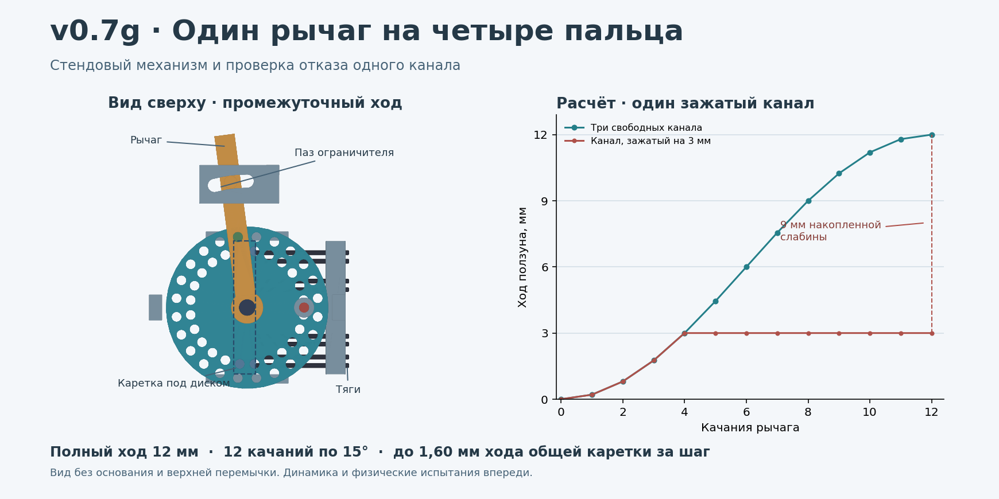

# v0.7g — общий рычаг освобождения четырёх пальцев

**11.11.2026. Стендовая архитектура и локальный CAD.** Основание: [мастер-промпт v4.2](../../docs/MASTER_PROMPT_v4.2.md), [шарнир v0.7e](../v0.7e/README.md), [аудит управления v0.7f](../v0.7f/README.md).



## Как устроен узел

Короткий кривошип радиусом 6 мм двигает общую каретку от 0 до 12 мм. В каретке четыре пары независимых удерживающих тяг. Для каждой пары предусмотрены два отдельных места крепления. Рабочие тяги должны идти к локальным ползунам v0.7e по оболочкам с опорами на соответствующих секторах. При открывающем моменте либо местном возвратном усилии ползуны могут следовать за выдаваемым ходом. Каретка ослабляет тяги; принудительно палец не открывается. В CAD показаны только прямые участки тяг и отверстия в общем узле. Реальные оболочки, длины, наконечники, возврат и влияние сгибания пальцев на трассу ещё предстоит проработать.

Рычаг качается на 15°. На диске два ряда отверстий для неподвижного стопорного и подвижного ведущего штифта. Механическая передача удержания должна идти в таком порядке:

1. Пока стопор держит диск, ведущий штифт входит в отверстие.
2. После полного входа ведущего штифта стопор выходит. Диск движется вместе с рычагом внутри замкнутого паза.
3. В конце шага неподвижный стопор входит в следующее отверстие.
4. Только после его полного входа ведущий штифт выходит и рычаг возвращается.

**Что показано:** два штифта, их посадки, дуговой упор и допустимые положения показаны в CAD. Обязательная последовательность проверена программным автоматом. Физическая блокировка между штифтами, пружины, привод одним пальцем правой руки и подтверждение полного входа ещё не спроектированы. Геометрический упор ограничивает ход при отпускании рычага, но не скорость движения до упора. Зависимость удержания от состояния стопоров рассматривается отдельно от демпфирования.

Пример конструкции с передачей удержания под нагрузкой — инструкция CM 640, в которой описаны функции храпового механизма рычажной тали. Это инженерный аналог принципа, без переноса её характеристик на протез. [Инструкция CM 640](https://www.ergonomicpartners.com/pdf/cm-640-series-come-along-lever-hoist-manual.pdf)

## Кинематика и расчёт

Поворот диска на 180° выдаёт 12 мм за **12 качаний**. При радиусе ручки 55 мм дуга рабочего качания — 14,4 мм. Это геометрия движения руки; время, перехват и усилие в перчатке пока не измерены. Самый большой номинальный шаг каретки 1,553 мм. Если учитывать только номинальный зазор 0,15 мм в дуговом упоре рычага и оба края углового шага, граница модели — 1,597 мм. Люфт штифтов, кабелей, податливость, трение и удар в эту величину не входят.

| Сценарий | Суммарная сила ползунов, Н | Момент диска, Н·м | Идеальное касательное усилие на рукоятке, Н | Работа силы на одном максимальном шаге, Дж |
|---|---:|---:|---:|---:|
| Стендовая гипотеза, 0,10 Н·м на каждый MCP | 38,49 | 0,231 | 4,20 | 0,061 |
| Целевые 10 кг, худшие плечи ползунов | 377,46 | 2,265 | 41,18 | 0,603 |
| Та же постановка с множителем ×2 | 754,92 | 4,529 | 82,35 | 1,206 |

Исходные плечи 40 мм от груза и 10,39 мм на упоре взяты из v0.7e. При одинаковом плече у ползунов эта упрощённая сумма одинакова для равномерного распределения и концентрации всей силы на одном пальце. Местная нагрузка, прочность тяги и ползуна меняются. Приведённая касательная сила учитывает квазистатическую реакцию от нагрузки; потери, остановка удара, удержание рычага и усилие разблокировки в неё не входят. Проверка штифта Ø3 мм — только средние напряжения по условному срезу и смятию. FEA и испытаний нет. Нужна отдельная модель изгиба, контактов, несущей рамы, отказов и износа.

## Клин одного канала и обрыв

- При остановке одного ползуна на 3 мм модель даёт ходы **3 / 12 / 12 / 12 мм**. Отдельные тяги становятся свободными независимо. Это допущение предполагает, что свободная тяга не цепляет остальные в общей оболочке.
- Если клин исчезнет после выдачи полного хода, у этого ползуна окажется **9 мм доступной слабины**. Общий стопор останется на месте, поэтому ограничение шага каретки на этот ход не распространяется. При условных постоянных 377,46 Н работа за этот локальный ход достигает **3,40 Дж**. Динамика и скорость движения не моделировались.
- При обрыве одной из двух тяг резервная в модели принимает нагрузку после выбора своего люфта. При заложенных 0,3 мм это 0,3 мм дополнительного хода. Допущения требуют отдельного крепления, предварительной настройки и подтверждённой способности второй тяги нести всю нагрузку своего канала. Обрыв обеих тяг либо отказ общей каретки могут открыть полный ход. Пружины, режимы износа и причины общего отказа не закрыты.

**Решение:** сохранить общий рычаг и независимую выдачу хода как стендовый вариант. Перед интеграцией нужен **локальный фиксатор или ограничитель у каждого ползуна**, который сохраняет удержание при наличии слабины. Проверяемый критерий — при клине на 3 мм, выдаче 12 мм общей кареткой и внезапном исчезновении клина ползун удерживается до следующей намеренной команды либо его перемещение ограничено одним отдельно заданным локальным шагом. Физический вариант такого фиксатора пока не выбран. Ход каретки также не определяет траекторию освобождённого предмета.

## Геометрия и установка

- **145 дискретных состояний**, 3 915 валидных состояний тел, 50 895 пар, 2 561 точная BRep-проверка после фильтра габаритов. В этих состояниях нет проникновений свыше 0,01 мм³. Намеренно опущенный между отверстиями стопор даёт 15,04 мм³ пересечения. Проверен номинальный CAD, непрерывная динамика и автоматическая передача удержания не проверены.
- Суммарный габарит стендового узла с траекторией рычага **63 × 81,09 × 27,25 мм**. Он включает основание и короткие участки тяг, но ещё без пыльника, пальцев руки оператора, шкивов и полного троса. В прямой осевой ориентации 63 мм превышают резерв запястья 50 мм.
- Из **72** пробных расположений консервативного габарита на открытом STEP v0.5d первые проходящие найдены при вынесении основания на +40 мм по вертикальной оси CAD. На высотах 0–30 мм все 48 проб пересекли референс. Это проверка конкретной ориентации и прямоугольного резерва, без вывода о других конструкциях. [Компоновка](packaging_results.json)

## Файлы и повторение

[STEP в исходном положении](exports/rocker_home.step.gz) · [STEP при передаче удержания](exports/rocker_moving.step.gz) · [STEP после полного хода](exports/rocker_full.step.gz) · [План стенда и детали](BENCH.md)

Каждый STEP содержит 27 тел, включая восемь условных прямых участков тяг. Все три файла повторно импортированы с проверкой валидности, количества и объёмов. Python 3.11+, CadQuery 2.7.0, для рисунка Matplotlib и NumPy.

```sh
python common_release.py
python -m unittest -v test_common_release.py
python common_cad.py --export exports
python layout_check.py
python preview.py
```
