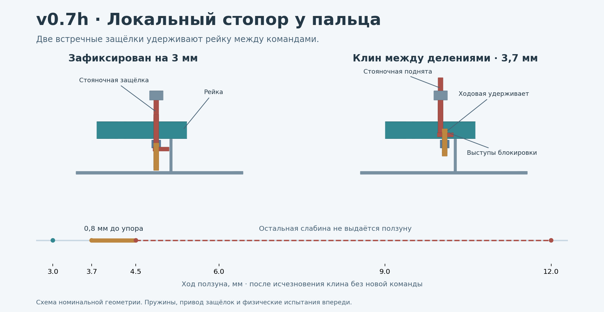

# v0.7h — локальный стопор ползуна при внезапном исчезновении клина

**11.11.2026. Одноканальная стендовая модель.** Основание — [мастер-промпт v4.2](../../docs/MASTER_PROMPT_v4.2.md), [шарнир v0.7e](../v0.7e/README.md) и [общая каретка v0.7g](../v0.7g/README.md). У v0.7g зажатый на 3 мм ползун после исчезновения клина мог выбрать до 9 мм слабины при общей выдаче 12 мм.



## Устройство

Рейка с двумя рядами прорезей движется на 12 мм. **Стояночная защёлка** входит сверху и удерживает рейку между командами. **Ходовая защёлка** входит снизу и закреплена на каретке с собственным жёстким упором. За один цикл каретка может пройти не более одного номинального деления 1,5 мм.

1. Пока стояночная защёлка держит рейку, ходовая входит в соседний ряд.
2. Стояночная поднимается. При открывающем моменте рейка и каретка вместе идут до жёсткого упора.
3. Стояночная опускается. Если рейка зажата между делениями, прорезь с ней не совмещена. Ходовая остаётся в рейке и ограничивает остаток движения до ближайшего упора.
4. После посадки стояночной ходовая может выйти, а каретка вернуться. Следующий шаг требует новой команды.

Встречные выступы защёлок движутся в противоположных направлениях. При попытке вывести обе выступы встречаются. В номинальной геометрии сумма ходов вывода ограничена зазором 2,45 мм. Полный вывод каждой защёлки требует 2,4 мм. В расчётном состоянии контакта одновременно остаётся не менее 0,975 мм перекрытия хотя бы одной защёлки с рейкой. При условном уменьшении исходного зацепления с 2,2 до 2,1 мм и увеличении зазора до 2,55 мм остаётся 0,825 мм. Это оценка жёстких деталей с фиксированными направляющими. Деформация, отлом выступа, перекос, люфт направляющих и состояние крепежа могут изменить результат.

CAD содержит защёлки, выступы, направляющие, рейку и упоры. Возвратные пружины и физический механизм, который формирует ровно один импульс на нажатие и позволяет повторно дать его при полностью выданной общей каретке, ещё не спроектированы. Одна удерживаемая команда и пропущенные команды проверены программно.

## Сценарии

| Условие | После исчезновения клина, без новой команды |
|---|---|
| Клин точно на 3,0 мм, общая каретка на 12 мм | 0 мм дополнительного хода в номинале, стояночная защёлка может сесть в исходную прорезь |
| Клин на 3,7 мм во время шага 3,0 → 4,5 мм | До 4,5 мм по номиналу, то есть остаток **0,8 мм**. С условным запасом на люфты — до **1,08 мм** дополнительного хода |
| Снятие клина в начале разрешённого шага | Не более 1,5 мм номинально. При условной сумме продольного зазора 0,18 мм и допуска упора 0,10 мм расчётная граница **1,78 мм** |
| Команды, пока ходовая защёлка удерживает ползун между делениями | В модели не накапливаются. После прихода на 4,5 мм следующий новый импульс может выдать ход до 6,0 мм |

Границы относятся к перемещению исправного стендового механизма в модели. Скорость, удар и возможность выпадения предмета остаются отдельными задачами. При условных 377,46 Н работа на полном шаге с учётом запаса на люфты составляет около 0,67 Дж, а на остатке 1,08 мм — около 0,41 Дж. Это произведение силы на ход, а не измеренная энергия или доказательство безопасного торможения.

Для v0.7g проверен расчётный график: за 12 качаний общей каретки ползун достигает 12 мм за восемь локальных шагов, если импульсы выдаются при достаточном ходе и ползун уже припаркован. Этот график требует механической реализации. Заклинивший канал в модели не блокирует три соседних. Требуется отдельно доказать доступ к повторному импульсу после исчезновения клина при полностью выданном общем ходе.

## Геометрия, нагрузка и размещение

- **309 дискретных CAD-состояний**, 4 944 валидных состояния тел, 37 080 пар, 4 173 точные BRep-проверки. Пересечений свыше 0,005 мм³ в заданных положениях нет. На границе запрещённого перехода 35 проверок показали столкновение встречных выступов (минимум 0,0567 мм³). Контроль попытки пройти жёсткий упор дал 0,897 мм³, контроль попытки посадить стояночную защёлку между делениями — 3,661 мм³. При крайних координатах полностью выведенные выступы могут геометрически оказаться по разные стороны. Непрерывный путь к этому состоянию при фиксированных направляющих пересекает запрещённую область. Разрушение, боковой уход и сборка с неверной ориентацией этим CAD не покрыты.
- Шаг 1,5 мм при ширине прорези 0,98 мм оставляет перемычку всего **0,52 мм**. При условных 377,46 Н, приходящихся на один палец, расчёт по равномерному контакту даёт около **143 МПа** давления на защёлку и **130 МПа** по упрощённой схеме среза перемычки. При ×2 значения примерно удваиваются. Контакты кромок, жёсткость выступов, усталость и фактический материал не проверены. FEA и физических испытаний нет. Нагрузка 10 кг остаётся целью, а не допуском.
- Габарит кассеты **28,1 × 15,8 × 16,25 мм**. По оси пальцев отдельный узел оставляет 2,6 мм до прежнего предела 18,85 мм. Это резерв только самой кассеты. Проверил 36 установок её прямоугольного резерва у сохранённых деталей v0.7e, по пять поз MCP на установку. Во всех 36 найдено пересечение хотя бы в одной позе. Точки крепления, тяги, оболочки и полный протез не интегрированы. [Результаты компоновки](interface_results.json)

Следующая конструктивная задача — перенести узел в пригодное место либо переделать силовую щёку MCP под его габарит, затем разработать физическую выдачу одиночного импульса и проверить удержание на стенде. Динамику проверять с независимым ловителем груза.

## Исходники и повторение

[Состояние на 3 мм](exports/local_park.step.gz) · [Клин между делениями](exports/local_jam_between.step.gz) · [Следующее деление 4,5 мм](exports/local_next_stop.step.gz) · [Материалы и стенд](BENCH.md)

Python 3.11+, CadQuery 2.7.0. Для рисунка нужны Matplotlib и NumPy. Все три STEP повторно импортированы. В каждом 16 валидных тел, суммарные объёмы совпали.

```sh
python local_hold.py
python -m unittest -v test_local_hold.py
python local_cad.py --export exports
python interface_check.py
python preview.py
```
