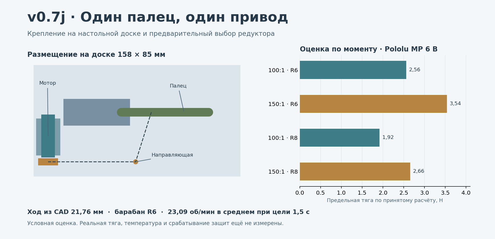

# v0.7j — измерение одного пальца и оценка сменного привода

**11.11.2026.** Следующий шаг [ручного макета v0.7i](../v0.7i/README.md) по [мастер-промпту v4.2](../../docs/MASTER_PROMPT_v4.2.md). Здесь есть способ получить тягу и ход, оценка двух мотор-редукторов и компоновка одного привода. Физических замеров и запуска мотора ещё не было.



## Сначала получить три пары чисел

Нужны закреплённая доска с макетом, линейка, пружинный динамометр малого диапазона и по возможности телефон на подставке. Подробности в [MEASURE.md](MEASURE.md). Начать со среднего отверстия пальца на 23 мм от оси. Записать **ход нити в миллиметрах, пиковую тягу в ньютонах и длительность прохода**. При отсутствии динамометра ход можно измерить сразу. Подбор по силе остаётся открытым.

Файл [measurements.csv](measurements.csv) пуст по измерениям. В него вносятся три повторения одной конфигурации. При смене отверстия, возвратного элемента или направления нити ведётся новый файл. Скрипт берёт худшие измеренные ход и тягу, диапазон длительности и считает кандидатов. Входные данные пользователь проверяет на измеримость и устойчивость. При медленной ручной тяге результаты характеризуют её условия. Для проверки цели 1,5 с нужно повторить серию на сопоставимой скорости.

```sh
python sizing.py --measurements measurements.csv
python sizing.py --example
python -m unittest -v test_sizing.py
```

Пример с 1, 2, 3 и 4 Н — условный. Он записан в [example_screen.json](example_screen.json).

## Расчёт барабана и мотора

На среднем отверстии v0.7i длина нити меняется на 21,76 мм за 60° **в CAD**. При эффективном радиусе намотки 6 мм это 0,577 рабочего оборота, 23,09 об/мин в среднем за 1,5 с. Для треугольного профиля скорости расчётный пик 46,18 об/мин. При радиусе 8 мм — 17,32 и 34,63 об/мин. Величина радиуса относится к оси нити. Вязка, стартовые обороты, второй слой, проскальзывание и потери учитываются отдельной примеркой.

Оценка момента равна измеренной тяге, умноженной на эффективный радиус и условный запас **1,5**. Измерение ведётся после рабочей направляющей, чтобы не считать её трение дважды. В качестве предварительного ограничения применено около **25% экстраполированного момента блокировки** Pololu. Линейная оценка скорости использует −20% от паспортных оборотов холостого хода и простой спад к точке блокировки. Это расчёт для паспортного питания 6 В. ШИМ на малой скорости, нагрев, способность держать позицию и защита при клине требуют стенда. Ток, который скрипт выводит по линейной модели, не является настроенным порогом отключения. [Рекомендации Pololu](https://www.pololu.com/product/5139/faqs)

| Эталонный кандидат | Холостой ход 6 В | Экстрап. момент блокировки | Тяга по условию момента, R6 | Тяга по условию момента, R8 |
|---|---:|---:|---:|---:|
| [Pololu 5139, MP 100:1 с энкодером](https://www.pololu.com/product/5139) | 220 об/мин | 0,94 кгс·см | 2,56 Н | 1,92 Н |
| [Pololu 5141, MP 150:1 с энкодером](https://www.pololu.com/product/5141) | 150 об/мин | 1,30 кгс·см | 3,54 Н | 2,66 Н |

При **условных** 3 Н и ходе 21,76 мм оба критерия проходит только 5141 с R6. При 4 Н оба мотора выходят за принятое ограничение момента на обоих барабанах. Эталонные Pololu используются для сопоставления известных характеристик. Выбор, закупка и настройки остаются за фактическими замерами. Оценка относится к одному пальцу без внешнего груза. Целевые 10 кг на всей кисти требуют отдельной силовой цепи и испытаний.

## Компоновка без специальной оснастки

Геометрия пальца, две щёки и ось взяты из v0.7i. Для примерки привода нужна доска около **158 × 85 × 8 мм** вместо 141 × 85. Доска шире на 17 мм в сторону за осью пальца. Под приводом один плоский подкладочный брусок, сверху съёмная лента/хомут. Координаты от оси пальца: центр барабана −56 мм по направлению к кончику, −38 мм в сторону сгибания, ось барабана на высоте 19,55 мм от нижней плоскости доски. Корпус ориентирован параллельно ширине основания. Нить идёт от прежней направляющей к барабану, который расположен за пальцем.

Проверено **61 положение от 0° до 60°**, 1 464 валидных состояния тел и 976 точных проверок пар. Проникновений выше 0,005 мм³ нет. Прямоугольник 10×32,5×12 мм — резерв под корпус и энкодер, не чертёж конкретного мотора. Разъём, провод, винты хомута, крепление барабана на валу, возврат, защитный экран и независимое механическое освобождение ещё не представлены в CAD. Первую примерку делать без питания.

- [Шаблон записи](measurements.csv) и [измерение одной рукой](MEASURE.md).
- [STEP 0°](mount_00deg.step.gz) и [STEP 60°](mount_60deg.step.gz). В каждом после импорта 24 валидных тела.
- `python mount_cad.py` — исходник компоновки. `python preview.py` — иллюстрация. Для CAD нужны CadQuery 2.7.0 и соседний каталог v0.7i, для рисунка Matplotlib.

## Переход к электрическому стенду

До запуска подтвердить посадку барабана на вал, установить физический предел рабочего хода, ограждение и независимое отключение питания двигателя. Отдельно испытать механическое ослабление нити с отключённым и неподвижным приводом. Отключение электричества само по себе может оставить редуктор в зацеплении. Для первого стенда с питанием нужен кнопочный режим с удержанием, ограничение тока и хода и явное разрешение после остановки. Физическая схема защиты ещё открыта. [ISO 22523](https://www.iso.org/standard/37546.html)

DRV8876 остаётся кандидатом для одного двигателя: рабочее питание 4,5–37 В, есть измерение и ограничение тока. Плату, доступ к сигналам и реальные настройки проверить перед подключением. Два канала ЭМГ пока остаются в [симуляторе v0.7a](../../software/v0.7a/README.md). Порядок после одного привода — проверка синтетических команд на стенде, затем отдельная проверка реального тракта и электробезопасности до контакта с кожей. [TI DRV8876](https://www.ti.com/product/DRV8876) · [IEC 60601-1](https://webstore.iec.ch/en/publication/2606)
