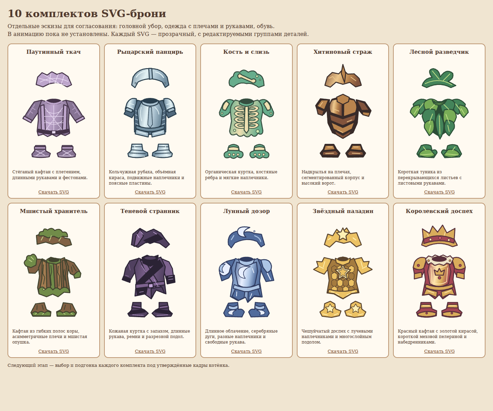

# 10 отдельных SVG-комплектов — реальный браузер

[Мобильная галерея 390×844](mobile-gallery.png). [Интерактивный просмотр](../../armor-design-review.html). [SVG-файлы и описание групп](../../art/armor-designs/README.md).

Это отрисовка исходных SVG в Chromium. Подгонка к котёнку и к кадрам движения отложена на следующий этап. `render-results.json` содержит версию браузера, размеры, прозрачность и проверенные группы деталей.
