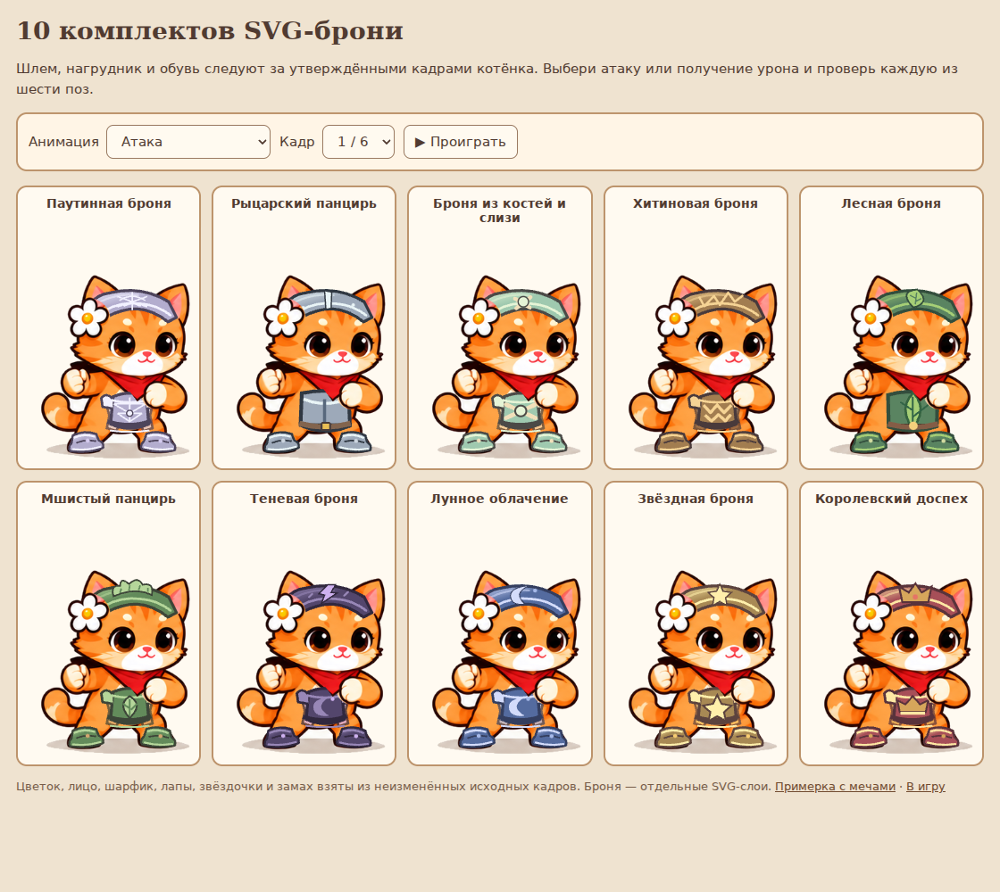
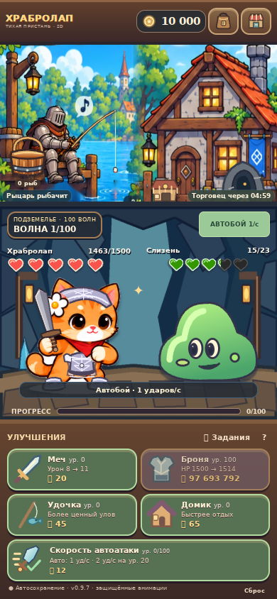
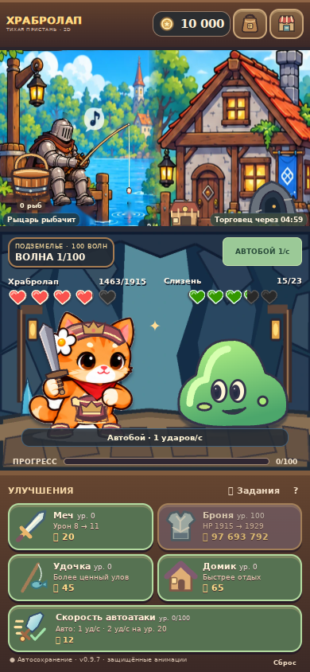

# Реальная примерка 10 SVG-комплектов

Изображения ниже получены из работающего Chromium, а не из генератора картинок. Сам котёнок использует прежние утверждённые PNG. Векторная броня накладывается отдельно.

## Все шесть поз

| Кадр | Атака | Получение урона |
| --- | --- | --- |
| 1 | [Скриншот](attack-01.png) | [Скриншот](hurt-01.png) |
| 2 | [Скриншот](attack-02.png) | [Скриншот](hurt-02.png) |
| 3 | [Скриншот](attack-03.png) | [Скриншот](hurt-03.png) |
| 4 | [Скриншот](attack-04.png) | [Скриншот](hurt-04.png) |
| 5 | [Скриншот](attack-05.png) | [Скриншот](hurt-05.png) |
| 6 | [Скриншот](attack-06.png) | [Скриншот](hurt-06.png) |

Последний кадр урона имеет собственные координаты: источник котёнка там расположен левее первого кадра. Мшистый шлем отличается порослью, теневой — руной, лунный — полумесяцем.

## В существующей игре

| Паутинный комплект | Королевский комплект |
| --- | --- |
|  |  |

Все десять комплектов надевались через настоящий инвентарь; проверены атака, урон, сохранение и reload на мобильном экране 390×844. Данные отрисовки 120 SVG и прозрачности защищённых точек: `vector-render-results.json`.

Интерактивный просмотр в сборке: `armor-review.html`. Примерка с десятью мечами: `equipment-preview.html`.
