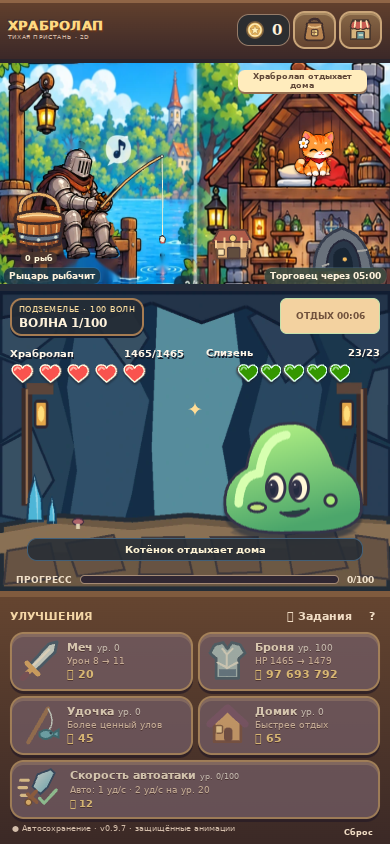
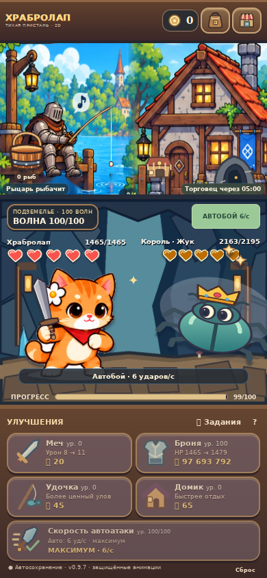
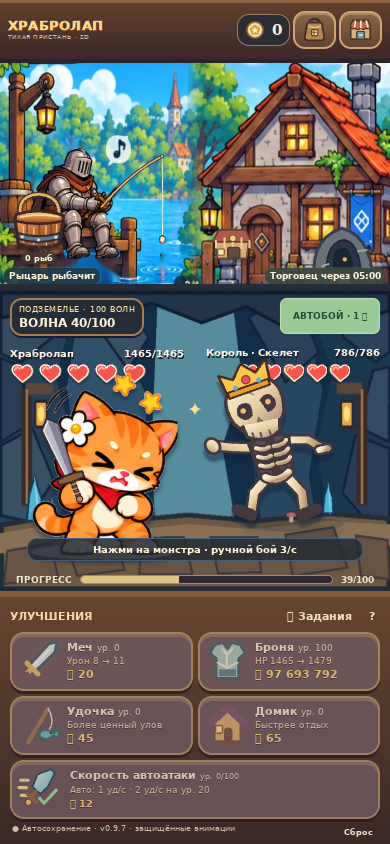
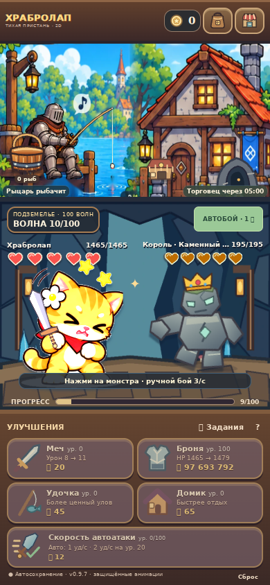
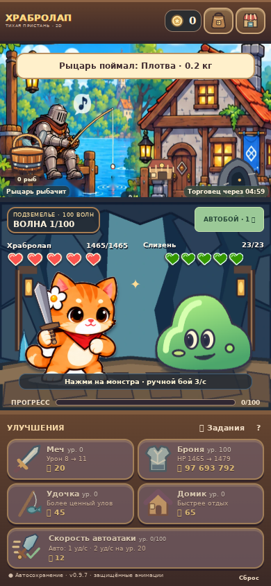
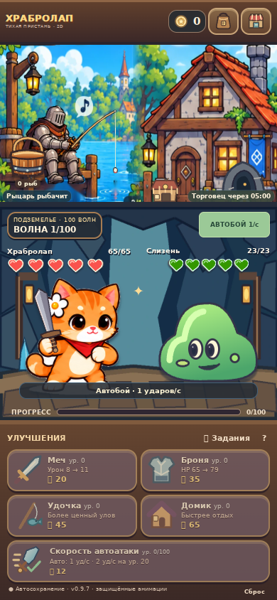

# Реальные скриншоты Храбролапа

Chromium 153, экран 390×844, мобильная эмуляция и touch. Это снимки работающей игры с подготовленными сохранениями. Генерация: `tools/capture_review.mjs`. Исходные PNG без ретуши.

| Мансарда: один новый котёнок | Максимальная скорость автоатаки |
| --- | --- |
|  |  |

| Скелет-босс: фаза атаки 4/6 | Голем-босс: фаза атаки 4/6 |
| --- | --- |
|  |  |

Девятый кадр укладки: рыба у края ведра, нижнюю часть закрывает передняя стенка. Счётчик увеличивается после завершения анимации.

## Исправление положения магазинчика

Последняя правка по визуальной приёмке: магазинчик опущен на пол. Этот снимок показывает актуальную высоту; пять снимков выше относятся к предыдущему этапу.

